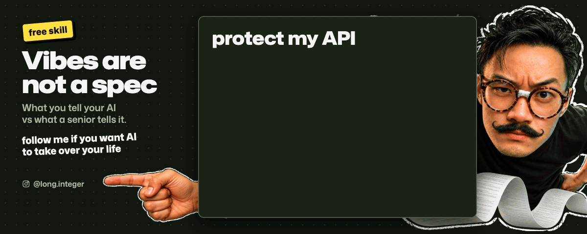

# Vibes are not a spec

[Watch the 15-second video](assets/video.mp4)

Your AI can interpret your words. It can't read your expectations.

You type three words. This skill turns them into the full job: what to check, how to prove it, how to fix it and when to stop. For people building real things with AI who aren't engineers.

## Install

In a coding agent that can fetch GitHub files (Claude Code, Codex), paste:

"Install the vibes-are-not-a-spec skill from https://github.com/open-longlabs/vibes-are-not-a-spec. The skill folder is vibes-are-not-a-spec and contains SKILL.md. Confirm the installed path."

Claude app: download [vibes-are-not-a-spec.zip](https://github.com/open-longlabs/vibes-are-not-a-spec/releases/latest/download/vibes-are-not-a-spec.zip), then open Customize > Skills and upload it as a skill.

## Use it

Say what you always say: "make it secure". Your agent now knows what that means.

| # | You say | What you haven't said |
|---|---|---|
| 1 | "Make it secure" | Secure against what? Who can see whose data? |
| 2 | "Make it look professional" | What should be consistent? |
| 3 | "Make it easy to use" | Can a first-time visitor finish without help? |
| 4 | "Make it work on my phone" | Does every button and form actually work? |
| 5 | "Make it automatic" | What triggers it? What happens when it fails? |
| 6 | "Make it smarter" | What should it know, decide or do differently? |
| 7 | "Make it fast" | Which action? How fast? On which device? |
| 8 | "Is it actually done?" | Did anyone test what happens when real users make mistakes? |
| 9 | "Fix it" | What broke? Why? How do we know it won't break again? |
| 10 | "Make it better" | Better for whom? What result are we improving? |

## Want to copy just one?

The `extras/playbooks` folder has every prompt on its own, with what it covers and its sources. "LARP" here means work that looks done but nobody proved it. Paste [the rules](extras/playbooks/00-rules.md) plus one playbook into any agent.

## What this is and isn't

A first version, informed by standards, vendor docs, firsthand research and our own engineering choices; sources or our reasoning are under each playbook in `extras`. We use these playbooks every day and teach them to people who take vibe coding seriously. In a test on a small app with 11 planted security holes, an agent with only this skill and the words "protect my API" fixed 10. It's a checklist, not a security audit: for anything that handles money or personal data, have a security person review it.

If it helped, leave a star ⭐

## More like this

Follow [@long.integer](https://instagram.com/long.integer) on Instagram for more automation tips and new skills.

Want the same for your company's workflows? I build these systems: [longlabs.tech](https://longlabs.tech)

MIT licence, see [LICENSE](LICENSE).
